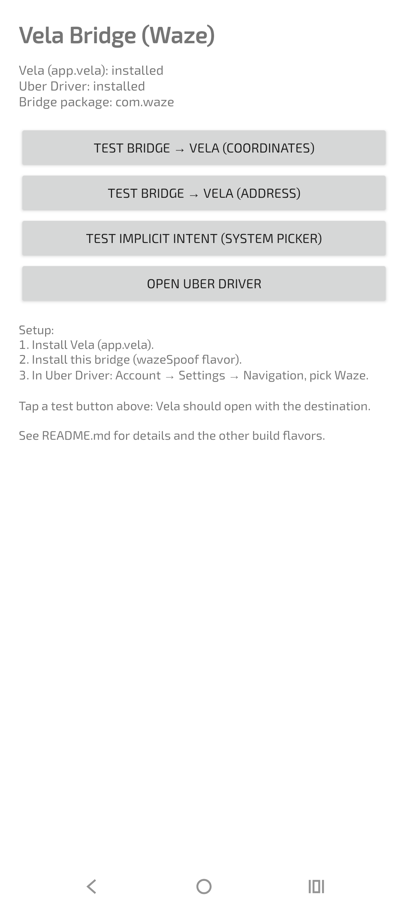

# Vela Bridge

Send Uber Driver navigation destinations to **[Vela](https://github.com/PimpinPumpkin/Vela)**
(`app.vela`) instead of Google Maps. No root required.

Inspired by [SmartTube's `stn_bridge_atv`](https://github.com/yuliskov/SmartTube):
an invisible bridge app takes the place of the navigation app, translates the
destination, and forwards it to the app you actually want.

## Disclaimer

**Vela Bridge is not affiliated with, endorsed by, or sponsored by Google LLC
or Waze.** "Waze" and "Google Maps" are trademarks of Google LLC. This project
uses the `com.waze` package name purely as a technical compatibility shim —
it is the only way to receive the navigation intents Uber Driver addresses to
the Waze package without root. This app is not Waze, does not provide Waze's
services, collects no data, and requests zero permissions. If you want the real
Waze, get it on the
[Play Store](https://play.google.com/store/apps/details?id=com.waze).

## YouTube Video showing Speed Cameras and Vela-Bridge with Uber Driver / Waze

[](https://youtu.be/3ihETwyiYbA)



# ANDROID AUTO
- https://github.com/PimpinPumpkin/Vela/issues/179

## Why Waze, not Google Maps?

Uber Driver sends navigation through **explicit intents locked to the Google
Maps package** (`com.google.android.apps.maps`). There is no chooser, no
system setting, and no intent filter that can intercept those — they go
straight to Google Maps, always.

You also can't *replace* Google Maps: it ships as a **system app**, and Android
will never let a third-party APK take its package name (the install fails on
the signature check — there is no no-root workaround).

**Waze is the way in.** Uber Driver also offers "Waze" as a navigation choice
whenever the `com.waze` package is installed — and Waze is a regular Play Store
app, not a system app. When it's not installed, its package name is free: this
bridge installs **as** `com.waze`, Uber offers "Waze", you select it, and every
Navigate goes bridge → Vela. Google Maps is never involved.

> ⚠️ In Uber Driver's navigation settings, **select "Waze" — not "Google
> Maps".** The "Google Maps" option will always open the real Google Maps;
> nothing can change that without root.

## Requirements

- Android 8.0+ (targets Android 16, API 36)
- [Vela](https://github.com/PimpinPumpkin/Vela) installed (`app.vela`)
- Uber Driver app
- The real **Waze must NOT be Update by Google Play / Other, it will wipe out the patch and have to re-patch.**
- No root, no adb required for the standard setup

## Setup (step by step)

### 1. Remove real Waze (if present)

The bridge needs the `com.waze` package name. If the real Waze is installed,
uninstall it normally (Settings → Apps → Waze → Uninstall).
- notice: if the uber driver app stops showing waze as an option after uninstall, then reinstall waze, goto uber driver app select waze, when you click navigate inside uber driver app make sure you select vela bridge not google maps/waze when the system picker comes on, Everyone is different - it works just have to play with it, find that sweet spot. Also never update the waze app or you'll have to re-patch.

If it was preloaded and can't be fully uninstalled, remove it for your user
via adb:

```
adb shell pm uninstall --user 0 com.waze
```

Verify it's gone:

```
adb shell pm path com.waze
```

This should print **nothing**. If it still shows a path under `/system`,
`/product`, or `/vendor`, Waze is a system app on your phone and this approach
won't work — see [Why Waze, not Google Maps?](#why-waze-not-google-maps).

### 2. Install the bridge

Take `app-wazeSpoof-release.apk` from [Releases](../../releases) and install it
(tap the file, or `adb install app-wazeSpoof-release.apk`). It installs as
"Waze" as far as the system is concerned — your launcher will show it as
**Vela Bridge (Waze)** so you know what it really is.

> Don't try to "update Waze" in the Play Store afterwards — the update will
> fail (signature mismatch). Ignore it or turn off auto-update.

### 3. Tell Uber Driver to use "Waze"

1. Open **Uber Driver**.
2. Go to **Account → Settings → Navigation**.
3. Select **Waze** (not Google Maps, not Uber's in-app navigation).
4. Accept a trip and tap **Navigate** — Vela should open with the destination,
   turn-by-turn ready. No chooser, no Google Maps.

That's it. Every Navigate from now on goes straight to Vela.

### 4. (Optional) Verify without a trip

Open **Vela Bridge (Waze)** from your launcher. It shows whether Vela and Uber
Driver are installed, and its test buttons fire the same intents Uber sends —
Vela should open with the test destination.

## How it works

```
Uber Driver → [Navigate]  ("Waze" selected)
      │  ACTION_VIEW   waze://?ll=<lat>,<lng>&navigate=yes
      │  (explicit to the com.waze package — which is this bridge)
      ▼
Vela Bridge  (invisible — no UI, finishes instantly)
      │  parses destination → geo:<lat>,<lng>  or  geo:0,0?q=<address>
      ▼  explicit intent to app.vela
Vela → turn-by-turn navigation
```

1. **Intercept** — `BridgeActivity` is installed as `com.waze` and declares
   `VIEW` filters for `waze:`, `google.navigation:`, `geo:`, and Google Maps
   https links, so Uber's Waze intents land on it.
2. **Translate** — `NavUriParser` extracts lat/lng or the address query from
   the Waze deep link (`waze://?ll=…&navigate=yes`).
3. **Forward** — the bridge fires the destination as a plain `geo:` URI
   **explicitly at `app.vela`**, so no chooser appears. Fallbacks (original
   URI → implicit `geo:`) cover anything unexpected.

## Build from source

In Android Studio: Build → Generate Signed App Bundle / APK → APK → select
the **`wazeSpoofRelease`** variant → sign with your key → Create. The APK lands
in `app/build/outputs/apk/wazeSpoof/release/`.

Or from the command line:

```
./gradlew assembleWazeSpoofRelease
```

Zero dependencies — pure Android framework, nothing to download besides the
Android Gradle Plugin itself.

## Build variants

| Variant | Package | Launcher label | Use when |
|---|---|---|---|
| `wazeSpoof` | `com.waze` | Vela Bridge (Waze) | **Uber Driver (recommended).** Passes Uber's "is Waze installed?" check; Uber's Waze intents land on the bridge → Vela. |
| `normal` | `app.vela.bridge` | Vela Bridge | Apps that fire *implicit* navigation intents (no hardcoded package). Installs as its own app, nothing to conflict with. |
| `mapsSpoof` | `com.google.android.apps.maps` | Vela Bridge | Only if Google Maps is a *user* app (`adb shell pm path` shows `/data/app/…`). **Dead on most phones** — Maps is a system app and Android rejects the install. |

## Troubleshooting

**Uber doesn't offer "Waze".**
The bridge isn't installed as `com.waze`. Check `adb shell pm path com.waze` —
it must print a path. If you installed the `normal` flavor by mistake, that's
`app.vela.bridge`, which Uber ignores — build `wazeSpoof` instead.

**"App not installed" / version downgrade when installing.**
Something already claims `com.waze` (real Waze, or a preloaded stub). Fully
remove it first — see step 1.

**Vela doesn't open when I tap Navigate.**
Is Vela (`app.vela`) actually installed? Use the bridge's launcher test
buttons — if Vela opens from those, the bridge is fine; re-check that "Waze"
(not "Google Maps") is selected in Uber's navigation settings.

**Navigate still opens Google Maps.**
"Waze" isn't selected in Uber Driver → Account → Settings → Navigation.
Select it — the "Google Maps" option always goes to the real Maps.

## Project layout

```
app/src/main/
├── AndroidManifest.xml          # VIEW filters: waze: / google.navigation: / geo: / Maps https links
├── java/app/vela/bridge/
│   ├── BridgeActivity.kt        # invisible bridge: catch → translate → forward to Vela
│   ├── NavUriParser.kt          # parses waze: / google.navigation: / geo: / https Maps URIs
│   └── MainActivity.kt          # launcher screen: install status + self-test buttons
└── res/                         # minimal resources, no external dependencies
```

## License

MIT — see [LICENSE](LICENSE).
